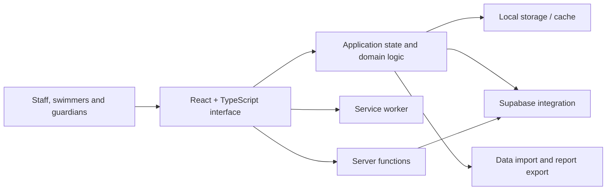

# Swimming club application — technical review

**React · TypeScript · PWA · Supabase integration · Data validation**

A software project addressing scheduling, attendance, competition communication and swimming results. This review connects the documented application design with a small piece of executable public code.

[Watch the 15-second presentation](media/presentacion-publica-segura.mp4) · [Read the Spanish case study](README.md) · [Inspect the code sample](examples/swim-times) · [Check CI](https://github.com/Malose3/swim-club-case-study/actions)

## Architecture at a glance

The diagram summarises the architecture already documented in the public case study. It describes responsibilities, not private schemas or a verified live deployment.



| Area | Technical responsibility | Review boundary |
| --- | --- | --- |
| React / TypeScript | Screens, components and application data types | The full implementation is private |
| PWA / service worker | Mobile access and resource caching | Resource caching does not establish offline data synchronisation |
| Supabase | Data and authentication integration | Deployed permissions require separate verification |
| Import / export | Parse external files, normalise values and report problems | Internal import rules and datasets remain private |
| Server functions | Server-side integration work | Endpoints, configuration and credentials are not included here |

## One public problem, end to end

A swimming time can be written as `1:02,35` or `62.35`. The sample turns both into integer hundredths, then formats a consistent display value.

```text
"1:02,35"
  → recognise minutes, seconds and fraction
  → validate the seconds field
  → (1 × 60 + 2) × 100 + 35
  → 6235
  → "01:02.35"
```

The implementation is small enough to read alongside its tests:

- [Parser and formatter](examples/swim-times/swim-times.mjs)
- [Six automated tests](examples/swim-times/swim-times.test.mjs)
- [Demo with invented values](examples/swim-times/demo.mjs)

### Input and output contract

| Function | Accepted input | Result on invalid input |
| --- | --- | --- |
| `parseSwimTime(input)` | A trimmed string in seconds or minutes:seconds, with an optional one- or two-digit decimal fraction using a point or comma | `null` |
| `formatSwimTime(centiseconds)` | An integer from 0 to 599999 | Throws `RangeError` |

The accepted range is `00:00.00` to `99:59.99`. A seconds field after a colon must be below 60. More than two decimal digits are rejected rather than rounded.

### Decisions and trade-offs

| Decision | Reason | Limit |
| --- | --- | --- |
| Integer hundredths internally | Makes exact comparison and round-trip formatting possible at the supported precision | Does not support finer timing precision |
| Strict parsing | Rejects ambiguous, incomplete or unsupported forms before formatting | Inputs outside the contract need explicit handling |
| `null` for parsing failures | Lets a caller handle invalid user text as an expected outcome | The caller still needs to provide a useful error message |
| Exception for invalid formatter values | Makes misuse of the internal numeric contract visible | Callers must supply a validated integer |
| Pure functions and no dependencies | Easy to run and test in isolation | Does not exercise the app's integration or UI |

### What the tests establish

1. Comma, point and seconds-only forms represent the same time.
2. One decimal digit means tenths, with surrounding whitespace handled.
3. Zero, complete minutes and the maximum supported time are accepted.
4. Ambiguous syntax and extra precision are rejected.
5. Unexpected types and out-of-range values are rejected.
6. Formatting and parsing preserves selected integer values exactly.

The six existing tests passed locally on **17 November 2026** using the public sample. The linked CI checks the same sample on repository changes. These checks cover the utility; they are not a security audit or a test of the complete application.

## Reproduce the sample

Requires Node.js 22 or later. From a fresh checkout:

```sh
git clone https://github.com/Malose3/swim-club-case-study.git
cd swim-club-case-study
node examples/swim-times/demo.mjs
node --test examples/swim-times/swim-times.test.mjs
```

No accounts, environment variables or third-party packages are needed.

## Product and engineering judgement

The broader project documents an import flow: choose a file, interpret its structure, normalise fields, separate accepted rows from problems and review the result before importing. The public time parser illustrates one validation concern, not that full pipeline.

Questions that matter before a wider rollout include failure recovery, consistency between local and remote state, access checks and testing with different user roles. The public repository does not claim that those production checks are complete.

## Contribution and publication scope

Manuel contributes domain knowledge, requirements, scope decisions, feedback and investigation of observed problems. AI assistants provide substantial implementation and documentation support. The sample is an educational adaptation with a stricter contract than the original utility, not a copy of the private application.

The public materials include this review, the case study, a short presentation and the isolated example. The full source, business rules, data model, access configuration, operational data and credentials remain private.

The video is a silent presentation assembled from three reviewed still images. It illustrates the interface and is not a recording of an interactive session.

[Back to the portfolio](https://github.com/Malose3)
